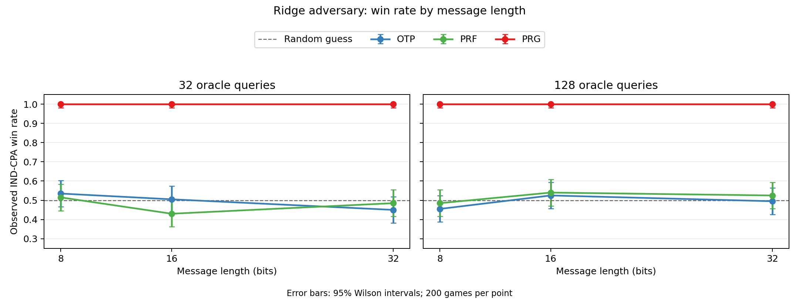

# Learning-Based Cryptographic Adversaries

An educational experiment for turning a cryptographic security game into a
measurable simulation. The current version runs an **IND-CPA-style game** with
a Ridge regression adversary against three encryption examples. It records
game win rates and plots the observed results.

This repository is a learning record and a starting point for comparing
classical, machine learning, and deep learning adversaries under explicit
query and computation budgets.

## Current experiment

For each independent game, the adversary makes a fixed number of randomly
chosen plaintext encryption queries and trains a Ridge model to approximate
decryption. It then chooses two distinct challenge messages and uses the model
to guess which one was encrypted. The CSV reports the fraction of correct
guesses and the estimated advantage `|win_rate - 0.5|`.

| Example | Encryption behavior in this simulation |
| --- | --- |
| OTP | Uses a fresh, independent random pad for every encryption. |
| PRF | Uses a random nonce and an HMAC-SHA256-derived pad. |
| PRG | Uses a SHAKE256-derived **fixed pad** that is reused for every encryption. |

The `PRG` label describes the intended fixed-pad example. Its seed and pad
currently have equal lengths, so this implementation is **not a formal
stretching PRG**. Reusing the pad is the property being tested in the CPA game.

## Run it

Requires Python 3.10 or newer.

```powershell
python -m venv .venv
.\.venv\Scripts\Activate.ps1
python -m pip install -r requirements.txt
python ind_cpa_regression.py --n 8 16 32 --queries 32 128 --trials 200 --output ind_cpa_results.csv
python plot_results.py ind_cpa_results.csv
```

The experiment command writes CSV without plotting. The second command reads
that CSV and creates the figures in `plots/`. Use `--help` on either script for
available options. Here `--n` sets **message length in bits**; values must be
positive multiples of eight. The default Ridge regularization is `alpha=1.0`.

## Recorded results

The checked-in run used 8, 16, and 32-bit messages; 32 and 128 queries; and 200
games per setting. The fixed-pad example won all 200 games in each setting.
OTP and PRF observed win rates ranged from 0.430 to 0.540. See the full
[results and interpretation](RESULTS.md), [CSV](ind_cpa_results.csv), and
[win-rate plot](plots/win_rate_by_message_length.png).



## Scope and limitations

- Only the IND-CPA-style simulation and Ridge adversary are implemented now.
  The 0.5 line in the plot is a reference, not a separately run random adversary.
- The displayed `n` is message length, not a formal cryptographic security
  parameter. The current PRF example also uses very short nonces.
- `--seed` controls NumPy's plaintext generation. Keys, nonces, challenge bits,
  and tie breaks use `secrets`, so exact CSV values can change on rerun.
- A finite set of games measures this adversary's observed behavior. It cannot
  prove IND-CPA or IND-EAV security, nor rule out other attacks.

