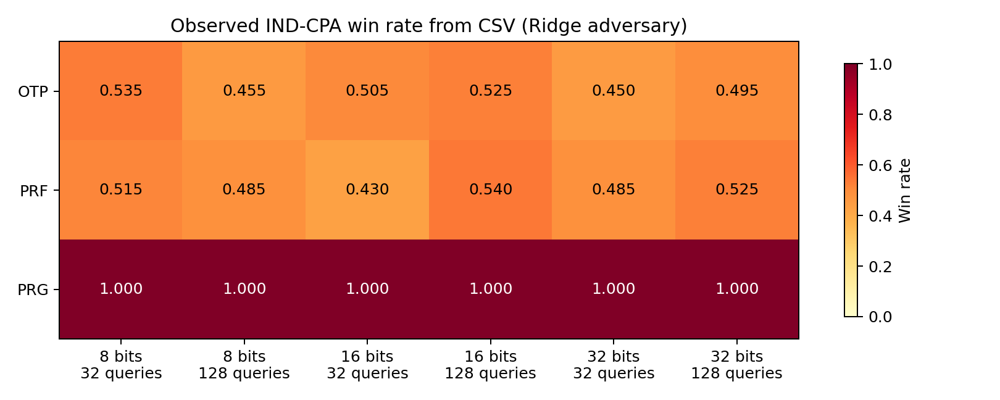

# IND-CPA simulation results

The experiment ran without `--plot`. The figures below were generated afterward
from [`ind_cpa_results.csv`](ind_cpa_results.csv) with `plot_results.py`.

```powershell
python ind_cpa_regression.py --n 8 16 32 --queries 32 128 --trials 200 --seed 2026 --output ind_cpa_results.csv
python plot_results.py ind_cpa_results.csv
```

The adversary uses Ridge regression (`alpha=1.0`) trained from randomly chosen
plaintext queries. Each row represents 200 independent games. Here `n` is the
**message length in bits**, not a formal security parameter. The `--seed` value
controls NumPy's plaintext generation; keys, nonces, challenge bits, and tie
breaks use `secrets`, so rerunning can produce different counts.


Error bars are 95% Wilson intervals calculated from `wins` and `trials` in the CSV.
The dashed line marks random guessing at 0.5.



The fixed-pad PRG example had 200/200 wins in all six settings. OTP and PRF
observations ranged from 0.430 to 0.540, near the random-guess baseline at this
sample size. These measurements describe this specific Ridge adversary and
finite experiment. They do not establish a security proof or a bound against
other adversaries.

The implementation currently tests **IND-CPA only**. The fixed-pad scheme is
CPA-insecure because it reuses the same pad, but its SHAKE256 seed and output have
equal lengths; it does not implement the stretch required for a formal PRG.
The PRF example uses short nonces at these settings, so the plots should not be
read as concrete security claims.
